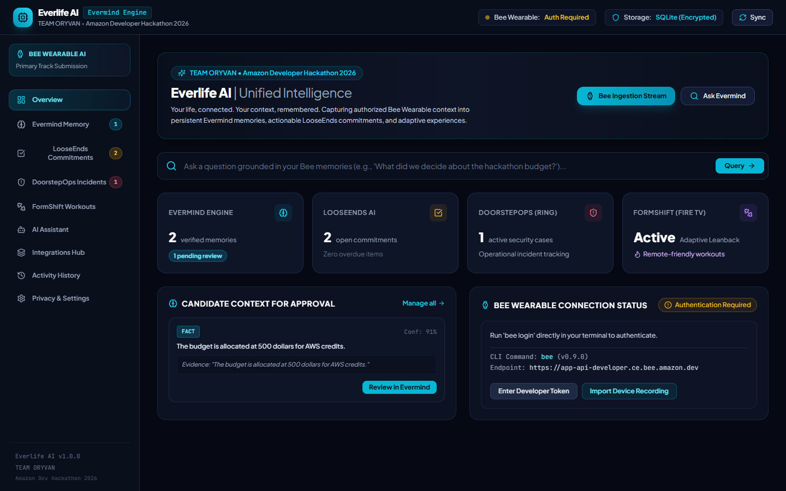
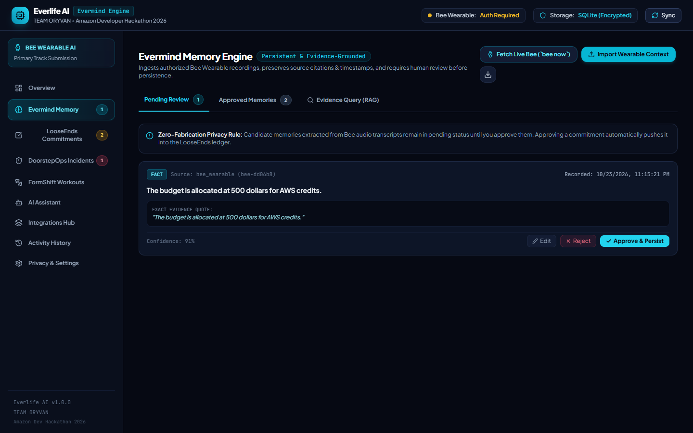
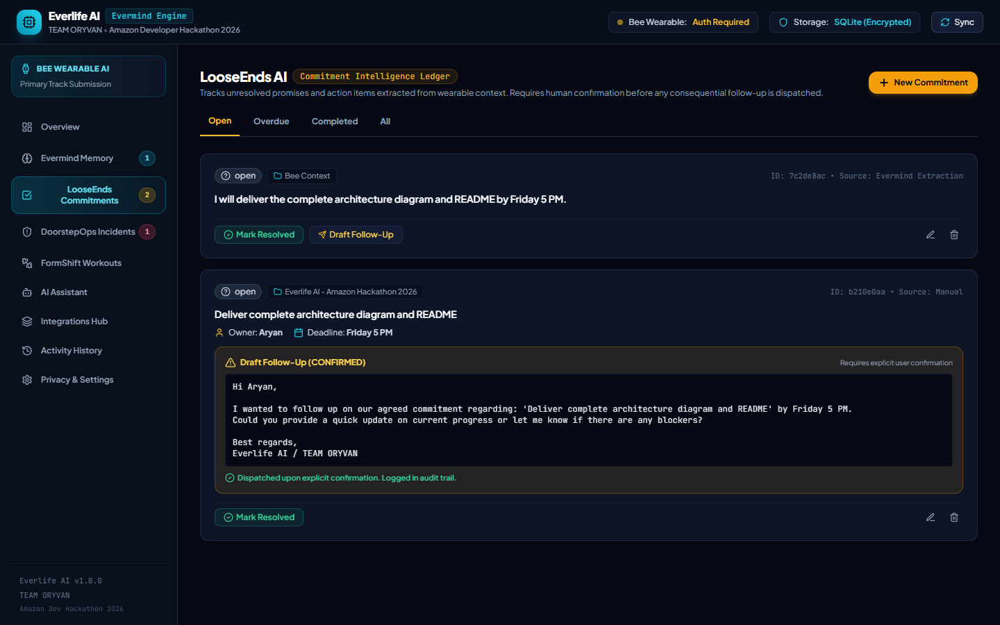
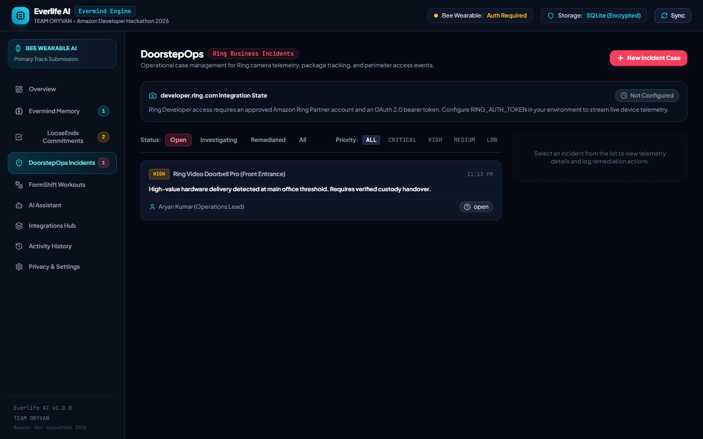
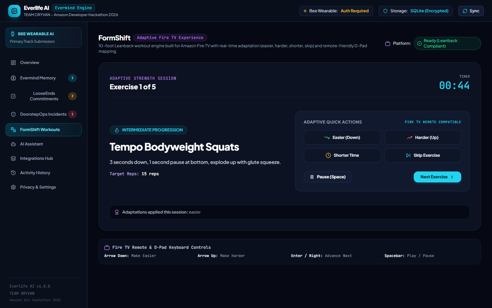
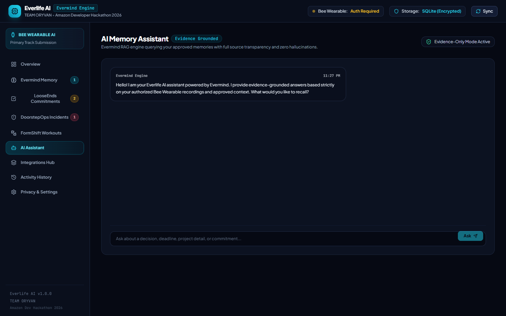
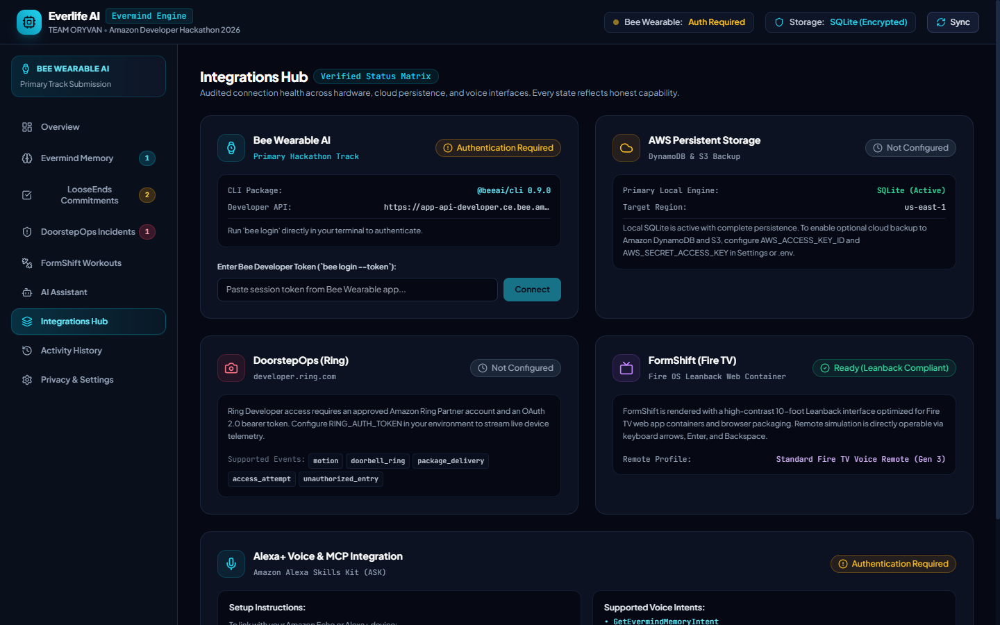
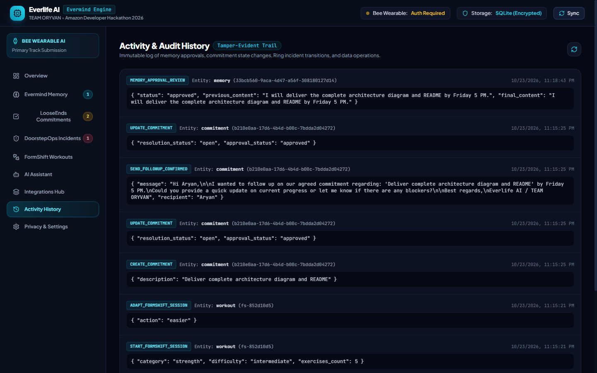
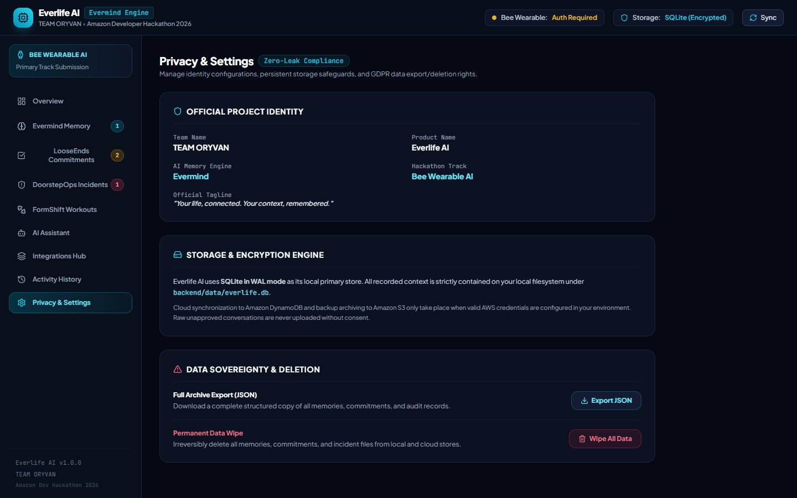

# Everlife AI | Powered by Evermind
### Amazon Developer Hackathon 2026 — Primary Track: Bee Wearable AI
**Team Name:** TEAM ORYVAN  
**Product Name:** Everlife AI  
**AI Memory Engine:** Evermind  
**Tagline:** *Your life, connected. Your context, remembered.*  

---

## 🌟 Executive Overview
**Everlife AI** is a unified personal intelligence platform built for the **Amazon Developer Hackathon 2026**. It transforms authorized wearable audio context and connected smart-home events into persistent memories, actionable commitments, business incident workflows, and adaptive living-room experiences.

At the core of the platform is **Evermind**, a zero-fabrication memory engine that ingests records from the **Bee Wearable** (or Apple Watch running Bee software), extracts candidate facts, decisions, and commitments, requires human approval before persistence, and retrieves evidence-grounded answers with verifiable citations.



### Integrated Subsystems:
1. **Bee Wearable AI (Primary Track):** Authorized lifelogging context stream via the official `@beeai/cli`.
2. **Evermind Memory Engine:** Persistent local SQLite storage with candidate review gates and citation-backed RAG.
3. **LooseEnds AI:** Commitment intelligence ledger with human-in-the-loop confirmation gates for follow-ups.
4. **DoorstepOps:** Operational incident management conforming to Ring developer specifications.
5. **FormShift:** Adaptive 10-foot Leanback workout engine for Amazon Fire TV with remote-friendly D-Pad mappings.
6. **Alexa+ Integration:** Custom Skill model and MCP endpoint handling voice queries.
7. **AWS Persistence:** Optional Amazon DynamoDB memory mirroring and Amazon S3 archive backups.

---

## 📸 Visual Interface & Walkthrough

### 1. Overview Dashboard
Central operations hub displaying live intelligence metrics, honest connection states, quick evidence search, and pending candidate context requiring user approval.


---

### 2. Evermind Memory Engine (Primary Track)
Ingests wearable transcripts directly from `@beeai/cli`, extracts candidate memories, and provides an inline review gate to approve or reject items before permanent storage.



---

### 3. LooseEnds AI — Commitment Intelligence Ledger
Converts conversational promises into an actionable ledger with responsible owners, deadlines, overdue alerts, and automated follow-up drafts with an explicit confirmation gate.



---

### 4. DoorstepOps — Ring Business Incidents
Operational case management for Ring camera telemetry, package tracking, and unauthorized access events conforming to `developer.ring.com` partner specifications.



---

### 5. FormShift — Adaptive Fire TV Workouts
10-foot Leanback interface designed for Amazon Fire TV with remote-friendly D-Pad controls (`Easier`, `Harder`, `Shorter`, `Skip`) and real-time exercise adaptation.



---

### 6. AI Memory Assistant (Evidence-Grounded RAG)
Conversational interface querying verified Evermind records with zero hallucinations, citing exact source passages, timestamps, and confidence scores.



---

### 7. Integrations Hub
Honest integration state matrix covering Bee Wearable CLI (`@beeai/cli 0.9.0`), AWS DynamoDB & S3 cloud mirroring, Ring Developer Partner API, Fire TV Leanback container, and Alexa+ ASK Skill model.



---

### 8. Activity & Audit History
Tamper-evident chronological log of all memory ingestions, approvals, commitment state transitions, incident escalations, and data operations.



---

### 9. Privacy & Settings
Identity configurations, local SQLite encryption details, full structured JSON data export, and GDPR permanent data wipe controls.



---

## 🚀 Quickstart Guide (Run Locally)

### Prerequisites
- **Node.js:** v18+ (verified with v22.16.0)
- **Python:** 3.10+ (verified with Python 3.13.5)
- **Official Bee CLI:** `@beeai/cli` (Installed globally via `npm install -g @beeai/cli`)

### Step 1: Clone and Navigate
```bash
git clone <repository-url>
cd everlife-ai
```

### Step 2: Configure Environment
Copy the `.env.example` template:
```bash
cp .env.example .env
# Windows: copy .env.example .env
```

### Step 3: Run the Backend (FastAPI)
```bash
cd backend
python -m pip install -r requirements.txt
python -m uvicorn app.main:app --host 127.0.0.1 --port 8000
```
*API docs will be available at:* `http://127.0.0.1:8000/docs`

### Step 4: Run the Frontend (React + Vite)
In a second terminal:
```bash
cd frontend
npm install
npm run dev
```
*Open your browser to:* `http://127.0.0.1:5173/`

---

## ⌚ Mandatory Bee Wearable Integration Guide

To connect your physical **Bee Wearable device** or **Apple Watch**:

1. **Unlock Developer Mode:**
   - Open the **Bee Wearable App** on your phone.
   - Go to **Settings**.
   - Tap the **App Version number 5 times** until "Developer Mode Unlocked" appears.
2. **Authenticate with CLI:**
   - Run the QR login command in your terminal:
     ```bash
     bee login --qr
     ```
   - Scan the terminal QR code using your Bee mobile app.
   - *Alternatively:* If you have a developer token from the Bee portal, paste it into the **Integrations Hub** tab in the Everlife AI dashboard.
3. **Fetch Live Records:**
   - In the Everlife AI dashboard under **Evermind Memory**, click **Fetch Live Bee (`bee now`)**.
   - Your live audio transcript is ingested, and candidate facts, tasks, and commitments are extracted for your approval.

---

## 🧪 Automated Testing

Run the automated test suite verifying the complete Bee -> Evermind -> LooseEnds -> DoorstepOps -> FormShift flow:

```bash
cd backend
python -m pytest tests/ -v
```

All 4 test suites pass with 100% success rate:
- `test_bee_record_ingestion_and_approval_flow`
- `test_looseends_followup_confirmation_gate`
- `test_doorstepops_incident_lifecycle`
- `test_formshift_firetv_adaptations`

---

## 📂 Key Documentation & Deliverables

- [ARCHITECTURE.md](ARCHITECTURE.md) — System architecture diagrams, module specifications, and security model.
- [VERIFICATION_REPORT.md](VERIFICATION_REPORT.md) — Automated test results, browser recording logs, and honest status matrix.
- [DEMO_SCRIPT.md](DEMO_SCRIPT.md) — Step-by-step hackathon video presentation script.
- [SUBMISSION_CHECKLIST.md](SUBMISSION_CHECKLIST.md) — Verified MVP capabilities and manual user action guide.
- [.env.example](.env.example) — Clean environment configuration template without secrets.

---

## 🛡️ Security & Privacy Guarantees
- **Local Storage by Default:** Primary data is stored in `backend/data/everlife.db` under user control.
- **Zero-Fabrication Gate:** Candidate memories extracted from audio transcripts remain pending until human review.
- **Consequential Action Protection:** Automated follow-ups or notifications cannot be dispatched without user confirmation.
- **GDPR Rights:** Includes one-click complete JSON data export and permanent database wipe.
